## Endpoint REST API (`/kos`)
- `GET /kos` — Mengambil seluruh daftar kos (`200 OK`)
- `GET /kos/:id` — Mengambil detail kos berdasarkan ID (`200 OK` / `404 Not Found`)
- `POST /kos` — Menambah data kos baru dengan validasi DTO (`201 Created` / `400 Bad Request` / `409 Conflict`)
- `PATCH /kos/:id` — Memperbarui data kos (`200 OK` / `404 Not Found`)
- `DELETE /kos/:id` — Menghapus data kos (`200 OK` / `404 Not Found`)

---

## Dokumentasi Pengujian (Screenshot)

### Pengujian Endpoint REST API (`test.http`)
1. **GET Semua Data Kos (`200 OK`)**

   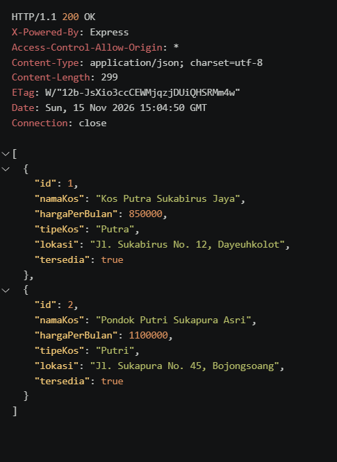

2. **POST Tambah Kos Baru (`201 Created`)**

   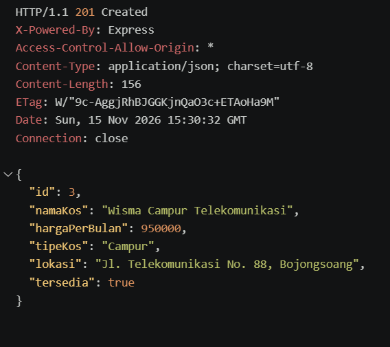

3. **GET Detail Kos by ID (`200 OK`)**

   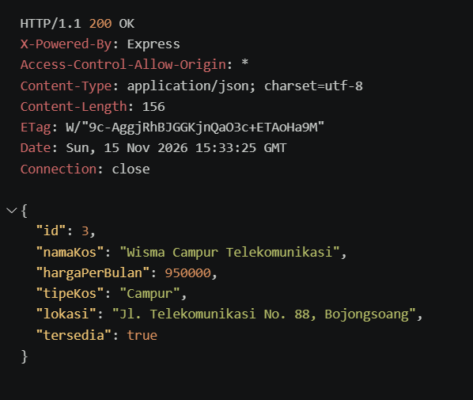

4. **PATCH Update Data Kos (`200 OK`)**

   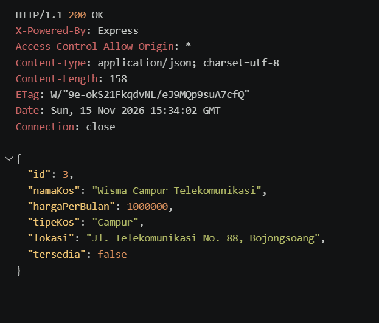

5. **DELETE Hapus Data Kos (`200 OK`)**

   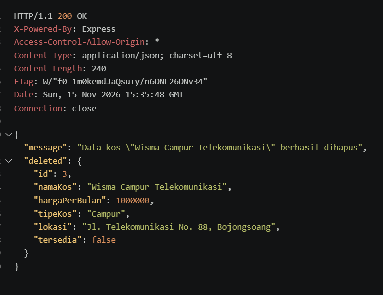

6. **Error Handling `409 Conflict` (Nama Kos Duplikat)**

   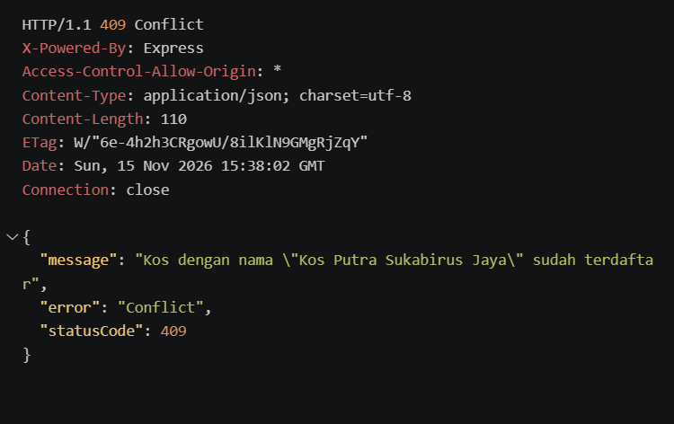

7. **Error Handling `404 Not Found` (ID Tidak Ditemukan)**

   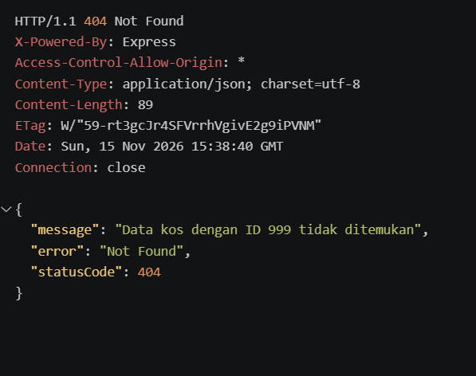

8. **Error Handling `400 Bad Request` (Validasi DTO Gagal)**

   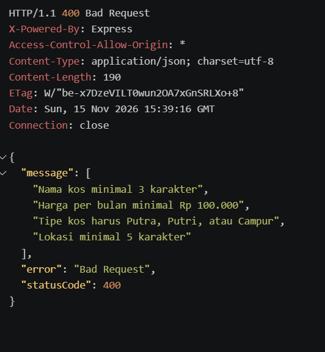

### Integrasi Frontend React & Backend NestJS
9. **Tambah Data Kos dari Halaman Web (`POST`)**

   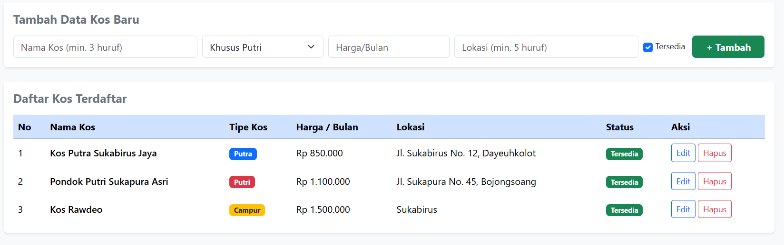

10. **Edit Data Kos dari Halaman Web (`PATCH`)**

    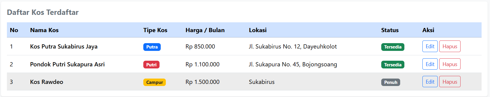

11. **Hapus Data Kos dari Halaman Web (`DELETE`)**

    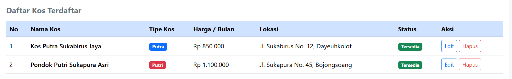